# Probyte

**The self-hosted database that syncs with your phone, works on the files you already have, and talks to your AI.**

Probyte is an Airtable/Teable-style database you run yourself: tables, formulas, links and seven kinds of views on PostgreSQL. What sets it apart is what it connects to. Your tables can *be* your phone's calendar, reminders and contacts. Your S3 bucket or Nextcloud folder can *be* a table you browse, preview and link. And Claude or ChatGPT can work with all of it, after you paste one URL.

<p align="center">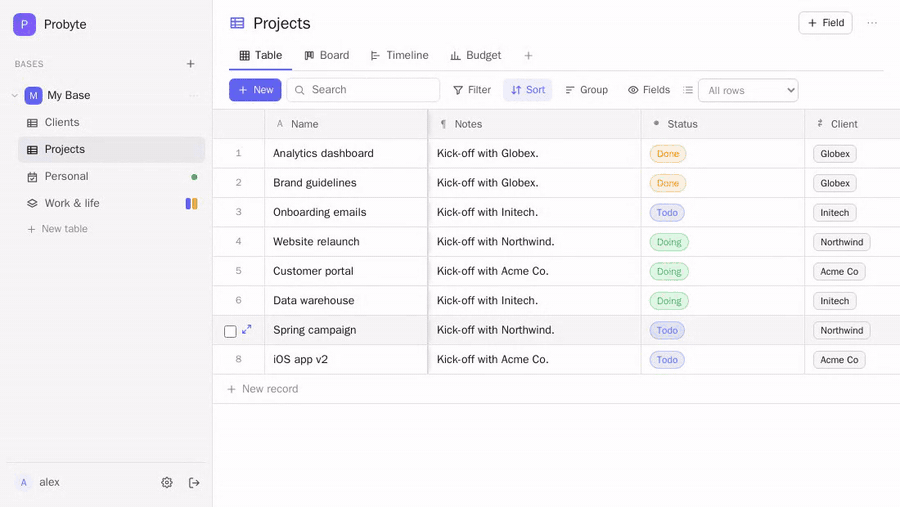</p>

## Why Probyte

**📅 Your tables are your phone's calendar, reminders and contacts.**
Not an export or a read-only feed: real two-way sync with CalDAV and CardDAV. Tick a task off in Apple Reminders and it's done in Probyte; drag an event on the calendar here and your phone moves it. Repeats, reminders and alerts, time zones and edits made offline all sync. A calendar server is built in, so it works out of the box, with your iPhone or any CalDAV app (DAVx5 on Android, Thunderbird…), or with your own CalDAV server such as Nextcloud, iCloud or Fastmail. [More ↓](#feature-tour)

**📁 Your files stay where they are, and become a database.**
Point a table at an **S3 bucket** (AWS, MinIO, Cloudflare R2, Backblaze, SeaweedFS…) or a **WebDAV folder** (Nextcloud, ownCloud, a NAS). Every file becomes a record you can search, tag, sort and link to your projects, clients or jobs. Open one and it's shown full screen, whole: PDF, **Word, PowerPoint, Excel**, video and images. Markdown files are edited WYSIWYG. Rename, move, upload whole folders or replace a file: the change happens in your storage, because Probyte never keeps its own copies. [More ↓](#files-tables-s3-and-webdav)

**🤖 Made for AI assistants.**
Probyte is an **MCP server** with proper sign-in (OAuth): paste its address into Claude, ChatGPT, Claude Code, Cursor or VS Code, approve read-only or read & write access for chosen bases, and the assistant can search, create and update your records. Alongside: a clean REST API (with OpenAPI docs and a **JSON Schema** of every table), signed webhooks with retries, and history that shows which edits an assistant made. [More ↓](#api-mcp-and-webhooks)

**🔗 Share a table as an app, and link tables across servers.**
A public link turns a view into a page anyone can open, embed, or **install on a phone** as its own app, with exactly the rights you choose (view, add, edit, delete), a password and an expiry date. Another Probyte server can add that link as a **linked table**, and **combined databases** merge tables, even from different servers, into one calendar, board or list. [More ↓](#public-links-embeds-and-phone-apps)

**🧮 Real spreadsheet power.**
Teable-compatible formulas (about 80 functions, with autocomplete and live preview), links, lookups, rollups and *conditional* lookups, validation rules and default values, and Table, Board, Calendar, Timeline, List, Gallery and Chart views. Also: keyboard-driven editing, pasting from Excel, nested filters, totals, and import/export in xlsx, csv, ods and json. [More ↓](#field-types)

**🏠 Yours to run, and hard to lose.**
One `docker compose up`, plain PostgreSQL, live updates in every open window, and 20,000-record tables that load in under a second. Daily backups (database, calendars and uploaded attachments) with one-command restore, a 30-day trash with **Undo**, per-record history, and encrypted stored passwords. [More ↓](#quick-start)

### At a glance

| | The usual no-code database | Probyte |
|---|---|---|
| **Calendar & contacts** | Export a read-only calendar feed | Two-way sync with your phone's Calendar, Reminders and Contacts |
| **Files** | Uploaded into the app, as attachments | Stay in your own S3 / WebDAV; previewed, edited and linked in place |
| **AI assistants** | An API key and glue code | MCP: paste the URL, sign in, done |
| **Sharing** | A view-only link | An installable app with add / edit / delete rights, usable from other servers |
| **Where it lives** | Someone else's cloud, often priced per seat | Your server, your PostgreSQL, your backups |

### Up and running

```bash
cp .env.example .env    # set a database password
docker compose up -d --build
```

Open http://localhost:8080 and create an account: the first one is the admin. [Full setup ↓](#quick-start)

## Screenshots

| | |
|---|---|
| 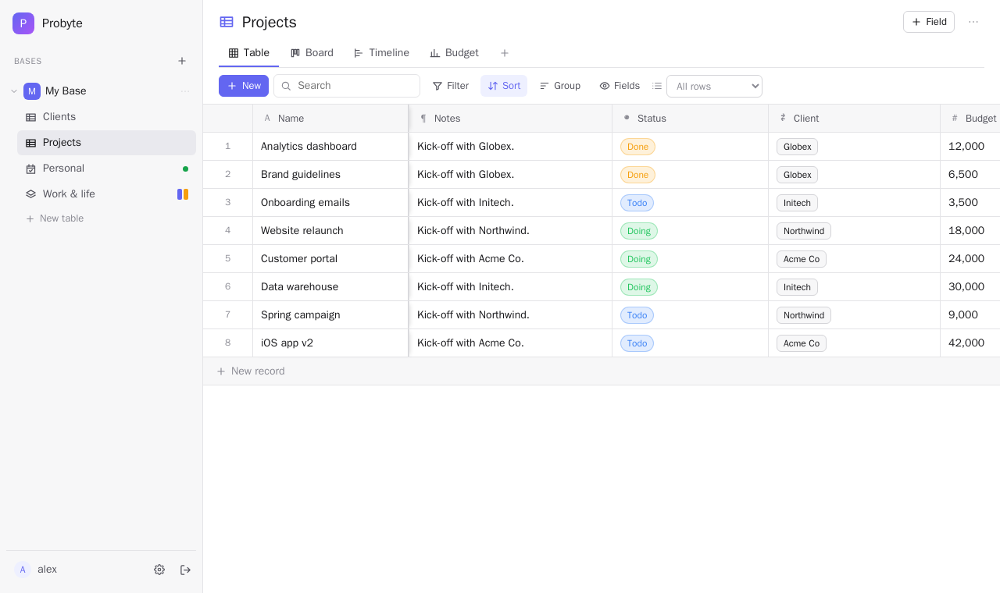 **Table** — links, lookups, formulas, a frozen title column | 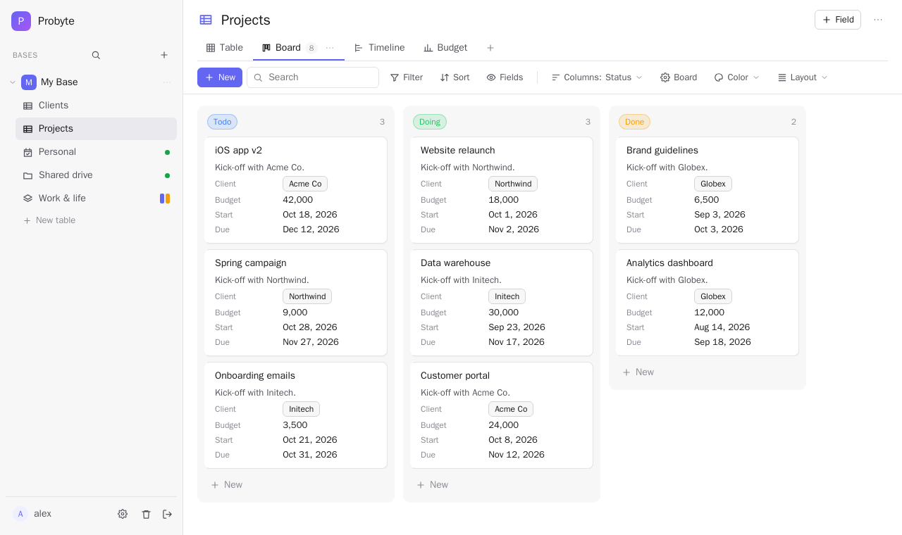 **Board** — drag cards between columns |
| 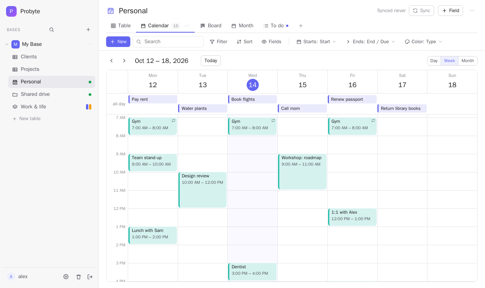 **Calendar** — tasks & events synced with your phone (week view) | 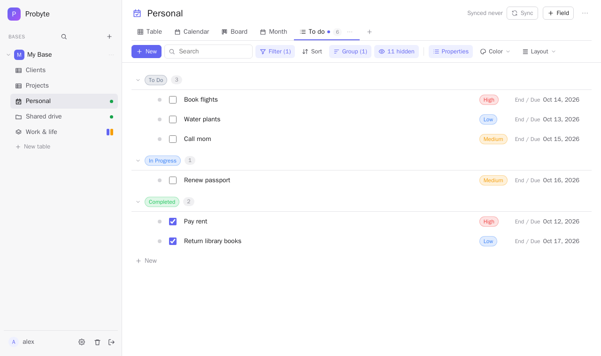 **List** — checkboxes first, grouped, columns that line up |
| 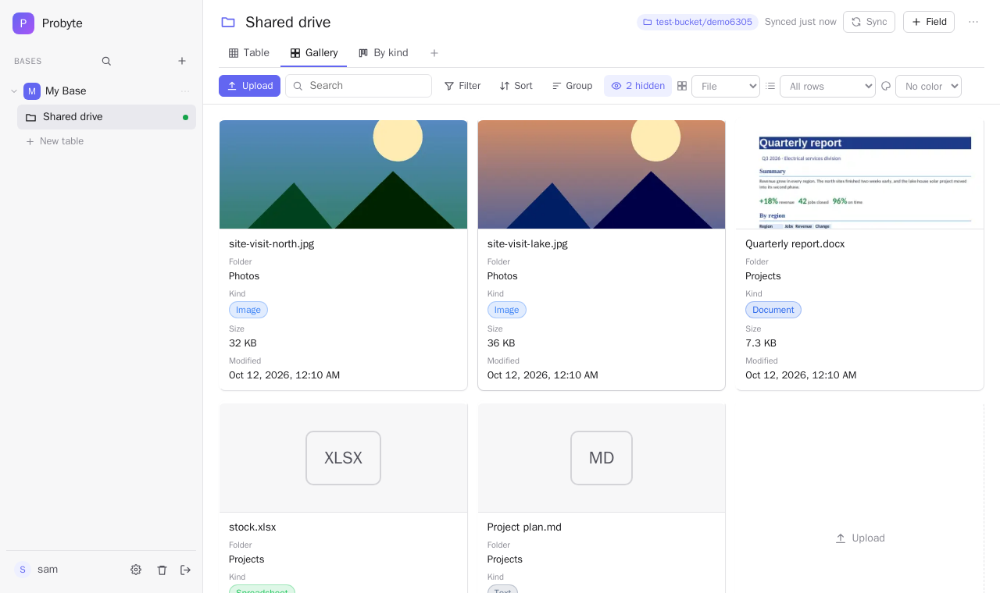 **Files** — an S3 bucket as a table, with cover images | 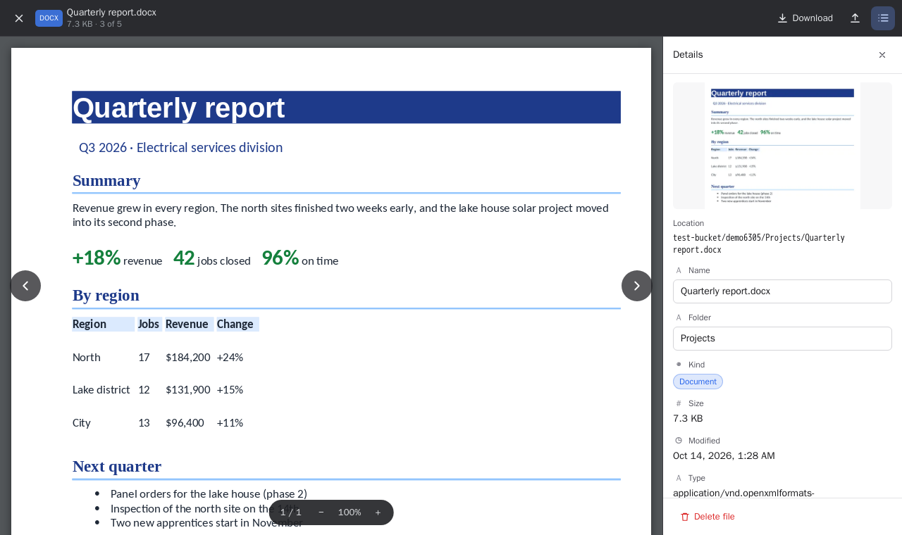 **File viewer** — Word, PDF, Excel and more, full screen |
| 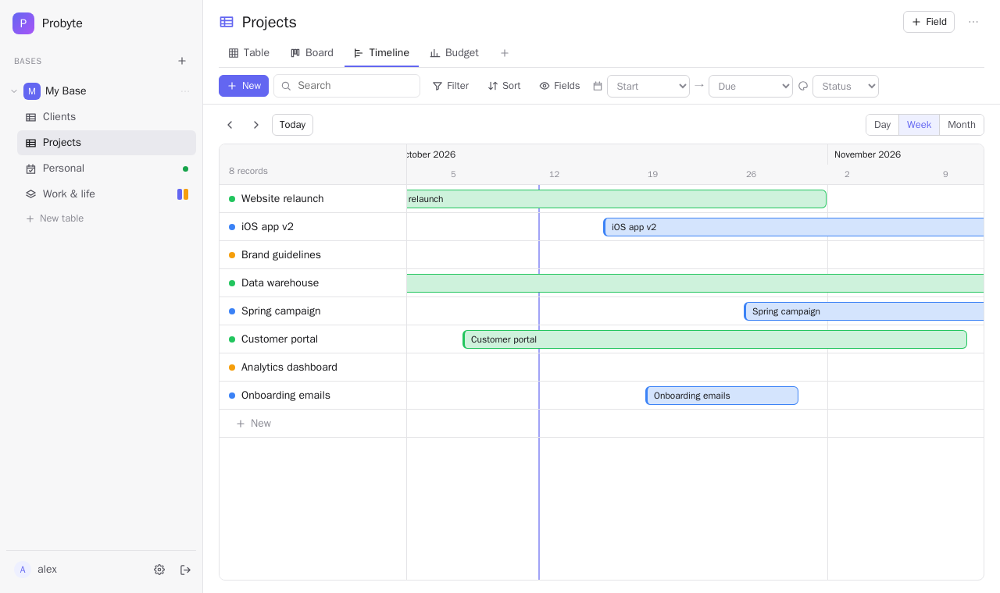 **Timeline** | 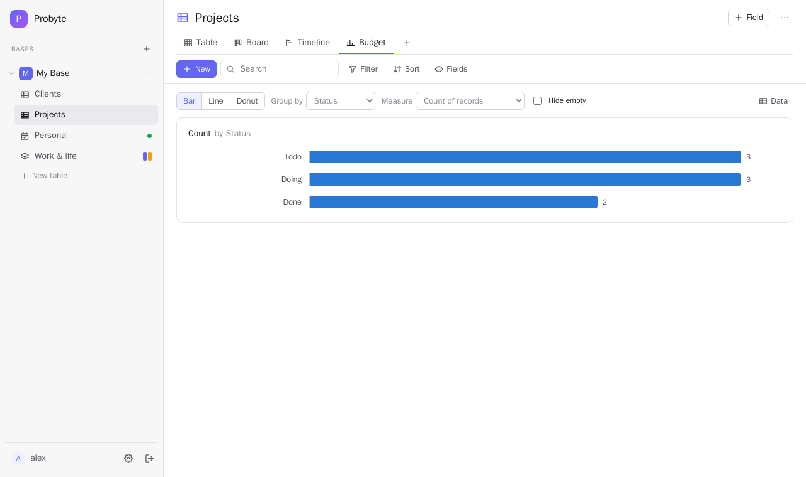 **Chart** |
| 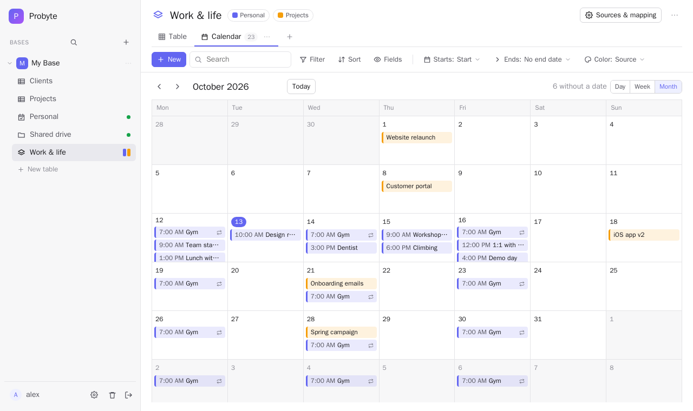 **Combined database** — several tables in one view, here as a calendar | 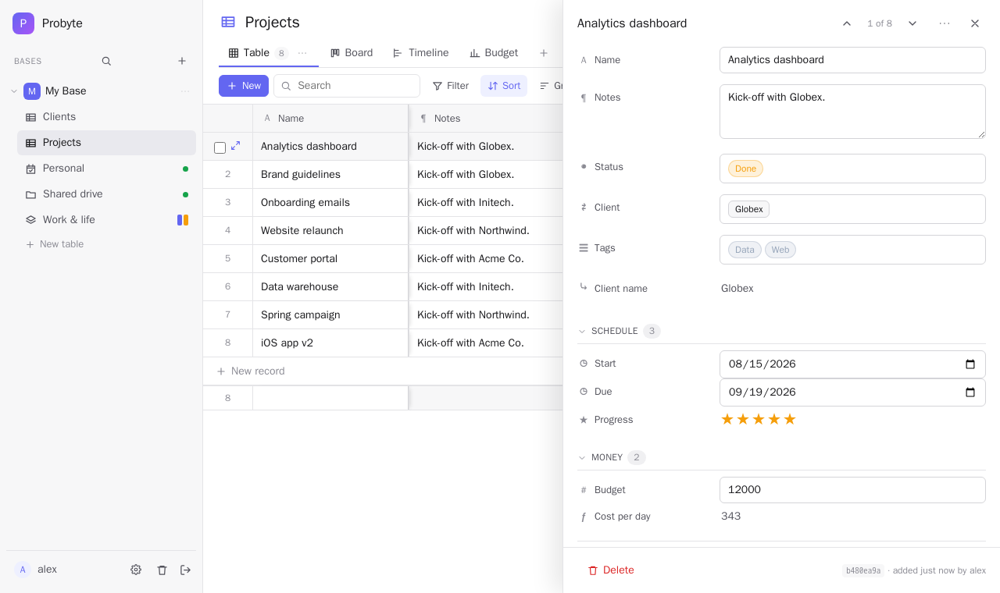 **Record panel** |
| 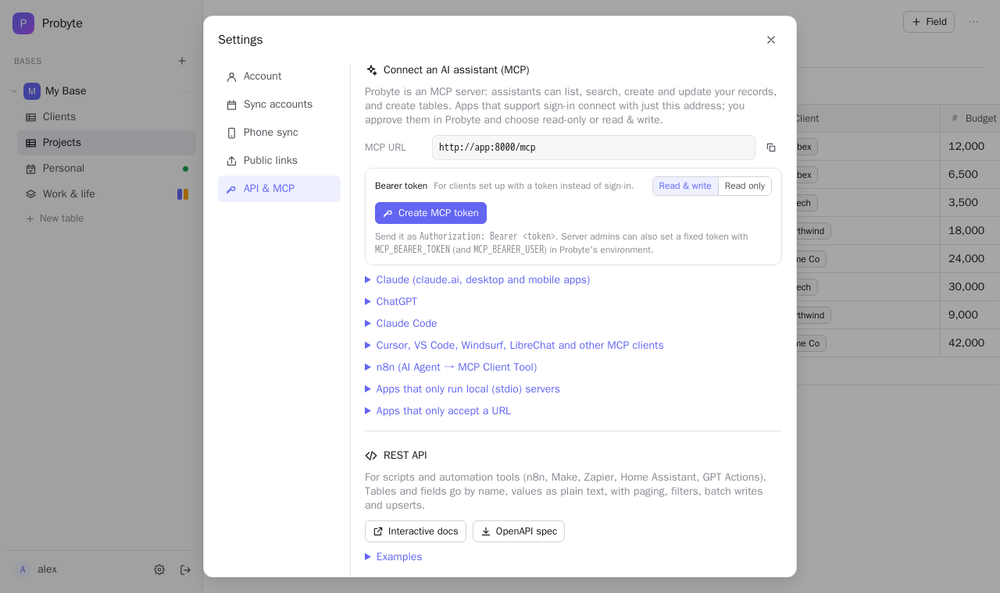 **API & MCP** — connect Claude and other assistants | 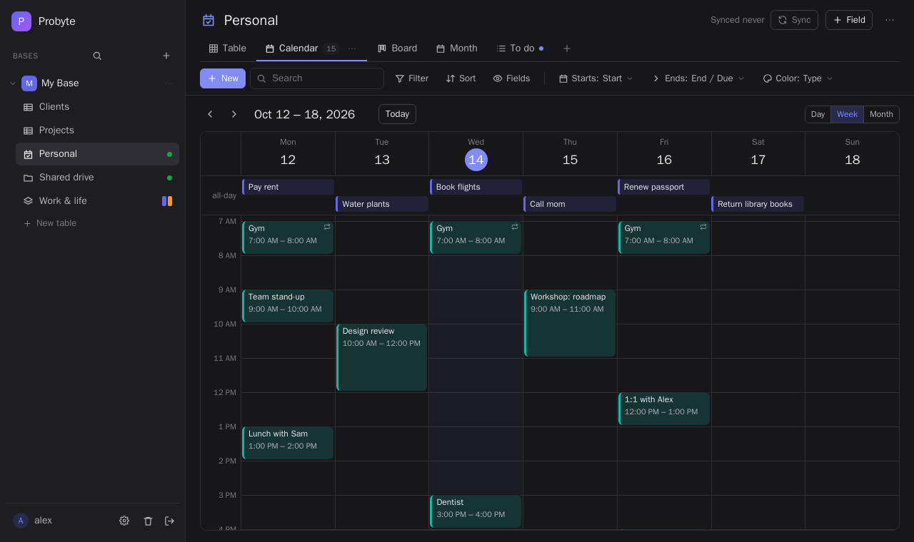 **Dark mode** |

<p align="center">
  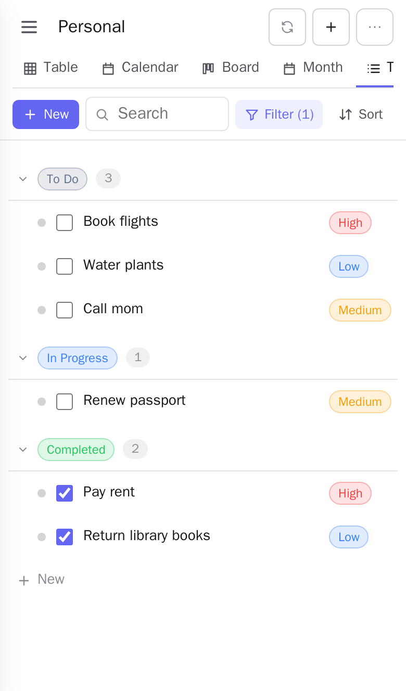
  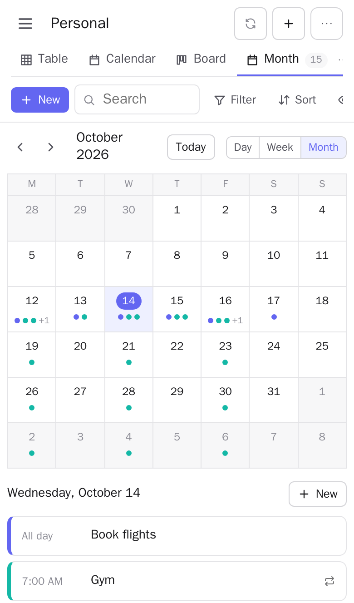
  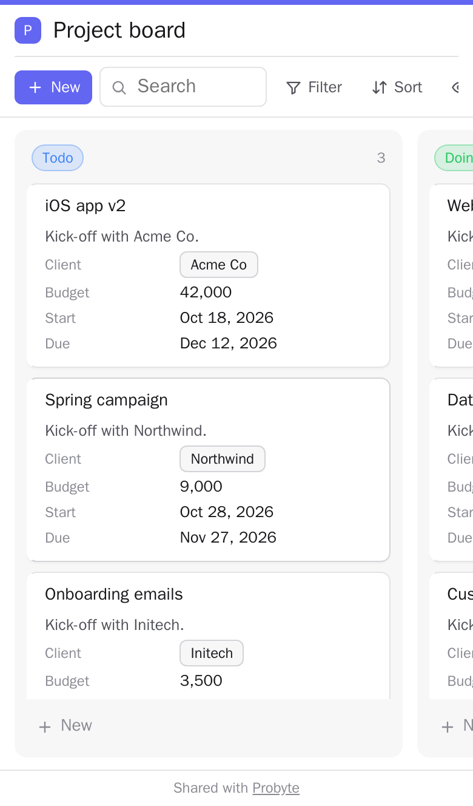
  <br><em>On a phone: a to-do list, the month with its agenda, and a public link anyone can open.</em>
</p>

<p align="center"></p>

The pictures are made by `scripts/test.sh screens` from demo data on the test stack; run it again after UI changes.

## Feature tour

Each user's work is organised as **bases → tables**. A base groups related tables (normal tables, synced calendar and contacts tables, files tables) and combined databases; use the sidebar to create, rename, recolour or delete bases, and a table's ⋯ menu to move it to another base.


1. **CalDAV task & event databases.** A database can be bound to a calendar collection and sync both ways with any CalDAV server (Nextcloud, Radicale, Baïkal, iCloud, Fastmail…). A **Tasks & events** table syncs a calendar's tasks (`VTODO`) and events (`VEVENT`) together; each record has a **Type** field (Task / Event), and the record panel shows only the fields that apply to that type. Pick a calendar that holds only events (as iCloud's do) or only tasks, and the table holds just those. (Tables made earlier as tasks-only or events-only keep working.)

   **Reminders.** Tasks and events have a **Reminder** field (at the time, 5 / 15 / 30 minutes, 1 / 2 hours, 1 / 2 days or a week before). It syncs as a standard calendar alert, so your phone notifies you: before an event's start, or before a task's due date (for an all-day task, 09:00 that day). Alerts set on a phone show up in the field, and an event's alerts are only rewritten when you change its Reminder.

   Each user can connect as many CalDAV accounts as they like.

   **Repeating tasks and events.** Tasks and events have a **Repeat** field (daily / weekly on chosen days / monthly on a date or the "2nd Tuesday" / yearly, every N, ending never / on a date / after N times). The calendar and timeline show every occurrence. Open one to **change that date only** (its title, start and end) or **skip it**, or drag it to another day on the calendar; edits in the rest of the panel apply to the whole series. Occurrences moved, renamed or cancelled on other devices show where they really are. Completing a repeating task moves it to its next date and keeps a completed copy of the finished one, like Apple Reminders. The Repeat field type can be added to any table too.

   **Contacts** tables work the same way over **CardDAV**: a table bound to an address book syncs vCards both ways (name, company, job title, email, phone, address, birthday, website, notes, groups). The same accounts are used; for providers with a separate contacts address (iCloud: `https://contacts.icloud.com/`), set the optional *Contacts (CardDAV) URL* on the account.
2. **Combined databases.** You can show several databases together as one: for example, tasks and events on a single calendar. Fields are lined up through a mapping (Title ↔ Title, Due ↔ End, Tags ↔ Tags…), and edits made in the combined view are written back to the source database.

3. **A built-in CalDAV server for phones.** Probyte ships with Radicale and creates a login on it for every user. A user adds that login on their iPhone, and their Probyte calendars show up in the Calendar app (events) and the Reminders app (tasks). Added as a CardDAV account too, their Contacts tables show up in the Contacts app.

Every database and combined database can have any number of Notion-style views, each with its own filters, sort, hidden fields and grouping:

| View | What it shows |
|---|---|
| **Table** | Spreadsheet grid; click a cell to edit it. Drag a column header to move the column, the title column included (the order is saved with the view). A column header's menu can **freeze** the columns up to it, so they stay put while the rest scrolls sideways. The footer shows a **summary** per column (click it): sum, average, min, max for numbers, earliest / latest for dates, filled, empty, unique and % filled for anything, checked / unchecked for checkboxes, over the view's records |
| **Board** | Kanban columns grouped by a single-select field; drag cards between columns |
| **Timeline** | Records as bars between a start and end date. Drag a bar to move it, or drag its edges to change the start or end. Day, week and month scales. Click an empty row to give an undated record dates. |
| **Calendar** | **Month**, **Week** and **Day**. Month: drag items to another day. Week/Day: a time grid with an all-day row (on phones the week scrolls sideways and opens on today); click a slot to add, drag a block to move it (15-minute steps, across days in Week), drag its bottom edge to change the end |
| **List** | One line per record: a color dot, the title, then properties shown as *name value*, with yes/no fields (like **Completed**) as checkboxes you can tick right there; Completed sits at the far right by default. **Properties** places each property at the **Start** (right after the dot, before the title, e.g. a to-do checkbox), **Left**, **Center** or **Right**, sets their order, and shows or hides each one's name. All rows share the same columns, so every property lines up straight at any window size; when the list gets narrower, properties drop off from the end instead of being squeezed or cut off. Rows are indented under their group headers |
| **Gallery** | Cards, with an optional cover image taken from a URL or text field |
| **Chart** | Bar, line or donut chart. Group by any field (dates by day, week or month) and show a count, sum or average of a number field. A **Data** toggle shows the underlying table. |

**Templates.** A table's fields (with their options, rules and defaults), views and, if you like, records can be saved as a **template** (Table settings → Template), and so can a single view (View settings → Template). **New table → From a template** makes a table from one of your templates, a template file someone shared, or a built-in starter (Job tracker, Project tracker, Clients, Inventory). The **+** next to a table's views adds a view from a view template; it's matched to that table's fields by name, and settings about fields the table doesn't have are left out. Templates download as `.json` files to share, and **Settings → Templates** lists, downloads, deletes and adds them. Links to other tables aren't part of a table template.

**Table settings and view settings.** A table's **⋯** (top right) opens its settings: name, icon, description, base, whether it's in the sidebar and its ID; its **fields** (the table's own field order, by dragging, and each field's editor); what it's connected to (a calendar table's **sync**, a files table's **storage**, a linked table's **link**, a combined database's **sources**); **calendar links** (only for tables with dates; not for files tables); **import & export**; and **delete**. Only what applies to that kind of table is shown. The open view tab's **⋯** (or a double-click) opens the **view settings**: its name, what kind of view it is (switching from table to board to calendar keeps its filters and fields), its layout (date fields, board columns, cover, colors, rows per page, frozen columns), fields (show, hide, rename and order for this view), filter, sort and group; and duplicate, move or delete it. **Drag view tabs** to reorder them.

**Filters, sorts and groups (like Teable).** **Filter** builds conditions joined by *and* / *or*, with nested **condition groups** (e.g. *Type is Event* **or** (*Status is In Progress* **and** *Type is Task*)); numbers and dates have greater/less than, before/after. A condition without a value is ignored until you fill it in. **Sort** takes several levels ("by Type, then by Title Z → A"). In Table, List and Gallery views, **Group** nests up to three levels (e.g. Type → Status); groups follow the field's option order (dates and numbers ascending, empty last), collapse with a click, and a group's **+** adds a record with that group's values. The same filters and sorts apply on public links and in the API's `view=`.

**Group headers.** Each group level has two switches in **Group**: **Title** (show that level's header row, e.g. "Event" / "Task", or let its records simply follow each other) and **Collapse arrow** (whether the header can fold its group away).

**Names per view.** **Fields** in the toolbar shows or hides each field and can give it a different name in that view only (e.g. "Remarks" for *Notes* in one view); the field itself, the API and formulas keep its real name.

**Table icons.** Click a table's (or combined database's) icon next to its title to pick an emoji from a searchable picker, or paste any emoji; it shows in the sidebar too. **Remove icon** goes back to the default.

**Calendar subscription links.** A table's (or combined database's) **⋯ → Subscribe in a calendar app…** makes a secret, read-only `.ics` address that Apple Calendar, Google Calendar, Outlook and others can subscribe to (buttons for webcal and Google Calendar are included). A link can follow a view, so only that view's records (its filters) are in the calendar and a calendar view's date fields are used; otherwise it uses the table's Start and End / Due, or its first date fields. Records without a date are left out; repeating items repeat. Calendar apps refresh it about hourly. **New address** replaces the secret (the old address stops working) and **Delete** removes it. Anyone with the address can read the calendar, without signing in.

**Adding records.** Every view has a **New** button left of the search box (also on public links that allow adding).

**Touch screens.** Dragging is a mouse/trackpad feature; on phones and tablets a tap opens an item and a swipe scrolls. Board cards have a **Move to** button, and dates are changed in the record panel.

**Pages.** Table, List and Gallery views can show their records in pages: pick **All rows** or 10, 25, 50, 100, 500 or 1000 per page in the view's toolbar.

**Hiding tables.** A table's (or combined database's) **⋯ → Hide from sidebar** keeps it out of the sidebar; **Show N hidden** under a base lists them again, and **⋯ → Show in sidebar** brings one back.

**First day of the week.** **Settings → Account → First day of the week** (Sunday, Monday…) is used by the calendar, timeline and weekly charts.

**Board options.** The **Board** button on a Board view shows or hides the "No *Status*" column (cards with no value), hides empty columns, and hides empty cards (no title and no other values).

**Combining tables from a table.** A table's **⋯ → Combine with other tables…** starts a combined database with that table already picked; a combined database's **⋯ → Add tables…** adds more sources. Both can also add a table **from another Probyte** by pasting its public link (on this server or any other). A combined database shows its own tables at once; sources from links load next to them (a spinner next to the title shows they're on their way).

**Keyboard, copy and paste (Table view).** Click a cell to select it; move with the arrow keys and Tab; start typing to replace its value, or press Enter / F2 (or double-click) to edit it; Delete clears it, Space ticks a checkbox, Escape leaves the cell. In the grid, Enter saves long text too (Shift+Enter for a new line). Ctrl/⌘ C copies the cell, or the ticked rows as a block; Ctrl/⌘ V pastes a block copied from Excel, Google Sheets or Numbers starting at the selected cell, converting each value to its field's type and adding rows if the block runs past the end.

**Search everything.** Ctrl/⌘ K (or the 🔍 in the sidebar) finds records in every table, by title or any other field, and opens the one you pick.

**Undo and the trash.** Deleting a record, deleting or editing several at once, or deleting a table shows **Undo** for a few seconds. Deleted records and tables also stay in the **Trash** (sidebar, bottom) for 30 days, where you can restore them or delete them for good. A deleted table's calendar on the server is only removed when the trash is emptied, so restoring a table brings back everything, phones included.

**History.** The record panel's **History** lists who changed what and when: you, an API key (by name), a connected AI assistant, a public link, or your phone through calendar sync, with each field's old and new value. Kept for 180 days.

**Selecting rows.** In a Table view, tick rows (shift-click selects a range, a group's box selects the group, the header box selects everything in the view), then **Edit** to set one field on all of them or **Delete** them.

**Import and export.** A table's **⋯ → Import from file…** reads CSV, TSV, Excel (.xlsx, .xls), OpenDocument (.ods), Numbers and JSON. You pick which column goes into which field, into a new field (type guessed from the data), or nowhere; values are converted to the field's type and rows are added. **⋯ → Export…** saves the current view (its filters, sort and fields, optionally the hidden ones too) as .xlsx, .csv, .tsv, .ods, .xls or .json.

**IDs.** Bases, tables, combined databases and records all have UUIDs. **Copy base ID** (base menu) and **Copy table ID** (table ⋯ menu) put them on the clipboard. Every table has a **Record ID** column with each row's UUID; it's hidden in every view by default — turn it on under **Fields**. The same IDs are used by the API (`/api/tables/{id}`, `/api/records/{id}`).

## Public links, embeds and phone apps

**Settings → Public links** lists your links, where you can create, edit, switch off, or delete them. Each link has these settings:

- a **base** and which of its tables and combined databases to show, plus **which views** of each
- what visitors can do: **view**, **add**, **edit** or **delete** records
- an optional **password** and **expiry date**, a name and a colour

A link works three ways:

| | |
|---|---|
| Web page | `https://your-probyte/s/<token>` |
| Embed | `<iframe src="https://your-probyte/s/<token>?embed=1">`. The code is in the link editor. |
| Phone app (PWA) | Open the link, then choose **Add to Home Screen** (iPhone) or **Install app** (Android). It installs with the link's own name, icon and colour. |

Visitors receive **only the fields visible in the shared views** and **only records that match each view's filters**. Filtering happens on the server, so nothing else reaches the browser. Link, user and attachment fields are read-only for visitors. "New URL" replaces a link's address and the old one stops working.

The main app installs the same way, as "Probyte", and works on phones: the sidebar becomes a menu drawer and dialogs open full screen.

## Files tables (S3 and WebDAV)

A **Files** table (New table → **Files**) shows the files in an **S3 bucket** (Amazon S3, MinIO, Cloudflare R2, Backblaze B2, Wasabi…) or a **WebDAV folder** (Nextcloud, ownCloud, a NAS…) as records, optionally only one folder of it. The files stay in your storage: Probyte doesn't keep copies.

- **Fixed fields**, like a calendar table's: **Name**, **File**, **Folder**, **Kind** (Image, Video, Audio, PDF, Document, Spreadsheet, Presentation, Text, Code, Archive, Other), **Size**, **Modified**, **Type** (the MIME type) and **Text**. Add your own fields next to them (tags, status, notes, links…); those are kept in Probyte.
- **Upload** takes the place of **New** in files tables: upload **files** or a whole **folder** (its subfolders kept), into the top level or a folder you name, or drop files and folders on the page. Uploads run three at a time with a progress panel and can be cancelled. A group's **+** (e.g. grouped by Folder) uploads into that group's folder. A name that's taken gets a number (`report (2).pdf`).
- **Rename and move**: editing **Name** renames the file in the storage, editing **Folder** moves it (folders are made as needed).
- **Full-screen viewer** (like Google Drive's): opening a file shows the whole file with **Download**, **Open in a new tab**, **Replace file** (a new version; the record, its fields and links stay) and the **details** on the right (location, every field; Name, Folder and your own fields can be changed there; delete). Arrow keys go to the previous / next file of the view.
  - **PDF**: every page, with zoom (the browser's own viewer on desktops; drawn with pdf.js on phones and elsewhere).
  - **Word, PowerPoint, OpenDocument, RTF** (.docx, .doc, .pptx, .ppt, .odt, .odp…): converted to PDF by the **office** service (LibreOffice) and shown page by page; the PDF is kept, so it opens instantly next time. Without the service, .docx files are drawn in the browser.
  - **Spreadsheets** (.xlsx, .xls, .ods, .numbers, .csv, .tsv): as a table with a tab per sheet (the first 5,000 rows).
  - **Markdown**: formatted, and edited as formatted text (**WYSIWYG**: headings, bold, lists, quotes, code, links), saved back as Markdown. **Text and code files**: shown and edited as text (Ctrl/⌘ S saves).
  - Images (click for actual size), video and audio play in place; anything else can be downloaded.
- **Cover images**: images (iPhone HEIC photos too), PDFs, Word / PowerPoint / OpenDocument files and spreadsheets (their first page, without blank margins) and text, Markdown and code files (their first lines, as a page) get a small preview image, used in the grid, the Gallery and the viewer. Files that don't have one yet (for example added before the document converter was set up) get it at the next sync; each version is tried once. Text files (and .docx) put their first 20,000 characters in **Text**, so search finds words inside them.
- **Link files to other tables**: a link field pointing at a files table gets **Upload files…** in its picker, which uploads into the files table and links the new records at once. A lookup of the **File** field shows the previews in the other table.
- **Changes in the storage** (from other apps, phones, the Nextcloud client…) arrive with the next sync: every `SYNC_INTERVAL`, on **Sync**, and right after the table is created. Up to 100,000 files per table.
- **Deleting**: a deleted record goes to the trash; its file is deleted from the storage when the trash is emptied (or after 30 days), and restoring the record keeps everything. Deleting the **table** never deletes the files.
- Connections are saved under **Settings → File storage** (secret keys and passwords encrypted) and can be shared by several tables. Uploads are limited to `FILES_MAX_UPLOAD_MB` (default 2048) per file; your reverse proxy may have its own limit.
- Public links that show a files table serve its files too (read-only).

## Linked tables (from any Probyte server)

Any Probyte public link, whether it's from this server or another Probyte server, can be added to one of your bases as a **linked table**. Choose **+ New table → From a link**, paste the link, enter its password if it has one, and pick which shared table and view to show.

- The data is **live**. It's fetched through the link (cached for a few seconds), so you always see the owner's current records, including their formula and lookup results.
- **The link owner's settings apply.** You see only the fields and records the link shares. You can add, edit or delete only what the owner allowed, and edits go straight into the owner's table. If the owner switches the link off, deletes it or changes its password, the linked table empties and shows why. **⋯ → Link settings** lets you re-enter a password or paste a new link.
- You can make **your own views** of a linked table (Table, Board, Calendar, Chart…). Its fields come from the source, so you can't add fields to it.
- **Merge** linked tables with your own tables in a **combined database**. For example, show a supplier's shared stock table next to your own orders, or a colleague's calendar next to yours. Each table's title column lines up automatically.
- **Link to them.** A *Link to record* field in your own table can point at a linked table's records, so you can pick them, and look up or roll up their values. The link is one-way, since the linked table's fields belong to its owner. If the owner deletes or stops sharing a record, it disappears from your links.
- **Linked combined databases:** if the link shares a combined database with several tables, **New record** asks which of the owner's tables the record goes into. The same choice appears, as "Name › Table", when that linked table is part of one of your own combined databases.
- Links to this same server are read directly. Links to other servers are fetched by this server, which doesn't follow redirects and **refuses private/internal network addresses**. If your Probyte servers talk to each other over a LAN or VPN, set `REMOTE_ALLOW_PRIVATE=true`.

## API, MCP and webhooks

Everything is under **Settings → API & MCP**.

**API keys** are **read-only** or **read & write**, cover **all bases or chosen ones**, and can expire. A key is shown once (Probyte stores only its hash). Send it as `Authorization: Bearer pbk_…` or `X-API-Key: pbk_…`. Keys work with data only, never with your password, CalDAV accounts, public links or other keys.

### REST API (`/api/v1`)

A stable API for scripts and automation tools (n8n, Make, Zapier, Home Assistant, GPT Actions). Interactive docs: `/api/v1/docs`; OpenAPI spec (with this server's address, ready to import): `/api/v1/openapi.json`.

- Tables by **id or name** (`?base=` if two bases share a name); fields keyed by **name**, or by **id** with `?fieldKeyType=id` (as in Teable; also `field_key=id`, and `field_key` in the MCP tools), so renaming a field never breaks an integration. Field ids are under the field editor's **Advanced properties**.
- Values written as **plain text**: `"2026-10-12"` / `"2026-10-12T15:30:00Z"` for dates, option names for selects, lists or `"a, b"` for multiple selects, record **titles** or ids for links, usernames for user fields. Unknown fields and unreadable values give a clear `400`.
- `GET …/records` supports `filter` (`{"Status": "Done"}` or `[{"field": "Due", "op": "lt", "value": "2026-11-01"}]`; ops `is, is_not, contains, not_contains, gt, gte, lt, lte, empty, not_empty`), `search`, `sort=-Due,Name`, `view`, `fields`, `limit` (≤ 1000) / `offset` with `next_offset`, and `cell_format=text` for values as shown in the app.
- Batch create / update / delete (up to 1000, all-or-nothing) and **upsert** (`match_on: ["Email"]`).
- Schema: list bases, describe a table, create tables and fields; trigger a CalDAV / files sync; search all tables.
- **JSON Schema** of any table or combined database: `GET /api/v1/tables/{table}/schema` returns a draft 2020-12 JSON Schema of a record's `fields` (each field's JSON type and format, select options as `enum` when only listed options are allowed, `required`, `readOnly`, `default`, descriptions), keyed by name or, with `fieldKeyType=id`, by field id. The MCP tool `get_json_schema` returns the same.

```bash
curl -G -H "Authorization: Bearer $KEY" https://your-probyte/api/v1/tables/Tasks/records \
     --data-urlencode 'filter={"Status": "To Do"}' -d sort=-Due
curl -H "Authorization: Bearer $KEY" -H "Content-Type: application/json" \
     -d '{"fields": {"Title": "Call the plumber", "Due": "2026-10-20"}}' https://your-probyte/api/v1/tables/Tasks/records
```

The older `/api/...` endpoints the web app uses keep working with keys too.

### MCP server (`/mcp`)

AI assistants can use Probyte through the Model Context Protocol: list bases, describe tables, list/search/get records, create, update, upsert and delete records, create tables and fields, and sync calendars. A read-only connection only gets the read tools.

- **Streamable HTTP** at `https://your-probyte/mcp` (current clients) and **HTTP+SSE** at `/mcp/sse` (older ones).
- **Sign-in (OAuth 2.1)** with dynamic client registration and PKCE, so Claude (claude.ai, desktop, mobile), ChatGPT connectors, Claude Code, Cursor, VS Code and others connect with just the URL. You approve the app on a Probyte page, choosing read-only or read & write and which bases; the connection becomes an API key labelled "connected app" that you can revoke.
- Or use a **bearer token**: **Create MCP token** in Settings makes a key to send as `Authorization: Bearer …`, or set a fixed `MCP_BEARER_TOKEN` (acting as `MCP_BEARER_USER`) in the environment. Any API key works the same way (n8n's MCP Client Tool, LibreChat, …), put the key in the URL (`/mcp?key=pbk_…`) for apps that accept only a URL, or bridge stdio-only apps with `npx -y mcp-remote https://your-probyte/mcp --header "Authorization: Bearer pbk_…"`.

Settings shows step-by-step instructions for each of these.

### Webhooks

Probyte POSTs `record.created`, `record.updated` and `record.deleted` events (with the record's fields by name) to your URL whenever records change, whether from the app, the API, an assistant, a public link or a phone sync. Pick the events and tables; changes to one record within a second become one event. Deliveries go through the worker's job queue: they survive restarts, and failures (no answer, HTTP 5xx or 429) are retried three times with backoff. Each request carries `X-Probyte-Signature: sha256=<HMAC-SHA256 of the body>` using the webhook's secret. Webhooks can also be managed through the API (`/api/v1/webhooks`). Addresses on your own network need `WEBHOOK_ALLOW_PRIVATE=true`.

## Field types

| Group | Types |
|---|---|
| Basic | Single line text, Long text, Number, Single select, Multiple select, User, Date, Rating, Checkbox, Attachment, URL, Email |
| Advanced | Formula, Link to record, Lookup, Rollup, Conditional lookup, Conditional rollup, Button, Auto number |
| System | Created time, Last modified time, Created by, Last modified by |

**The field editor** opens as a panel on the right (click a column header → **Edit field**, or **+** to add one):
- **Name**, an optional **description** (shown when hovering the column), and **Advanced properties** with the field's id.
- **Type**, with what it's for. Changing it converts the values (see below).
- **Options** for selects: drag to reorder, a colour each, Enter adds the next one. **Allow new options when editing** off means only the listed options can be picked (in the app, the API, imports and public links).
- **Formatting**: numbers as decimal, percent or currency (with a symbol), decimal places and thousands separators; dates as local, long, ISO, US or European, with or without time, in 12- or 24-hour format.
- **Field value validation rules**: **Required** (a record can't be added or saved with it empty; marked * on the column) and, for text, numbers, email, URL and dates, **Unique** (no two records share a value; case doesn't matter). Values synced in from phones aren't blocked.
- **Default value** for new records: text, a number, an option, checked, *today* / *now* for dates, or *whoever adds the record* for user fields.

- **Link to record** connects records across tables, or within one table. By default it is two-way: adding a link also creates the matching field in the other table, and the two stay in sync. Deleting a record removes it from every link that points to it.
- **Lookup** shows a field from the linked records. **Rollup** summarises it: count, sum, average, min, max, and/or/xor, join, unique.
- **Conditional lookup** and **Conditional rollup** don't need a link field. They pick records from any table that match conditions. A condition can compare against a fixed value or against a field of the current record, for example "Project contains {Name}". They can also sort and limit the matches.
- **Formula** works like Teable's:
  - Fields are referenced as `{Field name}`.
  - Operators are `+ - * / %`, `&`, `= != < > <= >=` and `&& || !`.
  - About 80 functions are available across the Numeric, Text, Logical, Date, Array and System groups. For example `IF`, `SWITCH`, `ROUND`, `REGEXP_REPLACE`, `DATE_ADD`, `DATETIME_DIFF`, `DATETIME_FORMAT`, `WORKDAY`, `ARRAY_JOIN` and `RECORD_ID`.
  - The editor has autocomplete, syntax highlighting, a searchable list of fields and functions with docs, and live validation with a preview on real records.
  - Formulas are stored by field ID, so renaming a field never breaks them. A formula that depends on itself, directly or through other fields, is rejected.
  - Date functions follow Teable exactly. `DATETIME_DIFF(date1, date2, [unit])` returns *date1 − date2*, defaulting to seconds; days and hours can be fractional. `FROMNOW`/`TONOW` both return *now − date*.
- **Button** either sets fields on the record (`now` / `today` work for dates) or opens a URL built from the record, such as `https://example.com/?q={Name}`.
- **Attachment** files are stored on the `attachments` volume, up to `MAX_UPLOAD_MB` (default 25) each. Files no record uses any more are deleted automatically within the hour (`ATTACHMENT_GC_INTERVAL`, in seconds; `0` turns this off). Images get thumbnails and can be gallery covers. Other file types are always downloaded rather than opened, so an uploaded file can never run code in Probyte.
- **User** fields can hold you, or anyone you add by their exact username. Probyte never lists other accounts.
- Computed fields are recalculated whenever records load, so they are never stale. Cross-table chains are supported; if two tables look each other up in a loop, the loop is broken.
- **Changing a field's type keeps its data.** Each value is converted from what you see: text ↔ numbers, dates, tags and checkboxes; names → linked records; usernames → users; a formula, lookup or rollup becomes its current values. Values that can't be converted are left empty. The field editor tells you what will happen before you save.
- **Large tables:** a 20,000-record table with formulas, lookups, rollups and conditional rollups loads in under a second on the server. The Table, List and Timeline views only draw the rows on screen. Board and Gallery show cards in pages ("Show more").

**Task dates:** task databases, and tasks in *tasks & events* databases, have **Started At** and **Completed At** fields:
- Moving a task to *In Progress* stamps Started At.
- *Completed* stamps Completed At.
- Moving it back clears them.
- You can still edit both by hand.

Completed At syncs with the standard iCalendar `COMPLETED` property, so phones see it. Started At is stored as `X-PROBYTE-STARTED`; if another app drops that property, Probyte keeps its own value.

## Quick start

```bash
cp .env.example .env    # then edit it
docker compose up -d --build
```

This starts five containers: `app` (web app and API), `worker` (calendar and file syncs, webhook deliveries, previews and cleanup, from a job queue in Postgres), `db` (Postgres), `radicale` (the bundled CalDAV/CardDAV server) and `office` (converts Word / PowerPoint files to PDF for previews; internal only). Database migrations run automatically on start.

Open http://localhost:8080 and create an account. The first account becomes the admin, and any data created before multi-user support belongs to it. Each user only sees their own databases, combined databases and CalDAV accounts.

Every new user automatically gets a **Probyte CalDAV** account, which is their login on the bundled Radicale. To sync with a phone:

1. In Probyte, click **+ (Databases)**, choose **Tasks & events** (or Tasks / Events), keep the account set to **Probyte CalDAV**, and create a new calendar.
2. Open **your name (bottom left) → Sync with your phone**. It shows the server address, username and a generated device password.
3. On the iPhone go to **Settings → Apps → Calendar → Calendar Accounts → Add Account → Other → Add CalDAV Account**, enter those three values, and turn on Calendars and Reminders.

For contacts, create a table with **New table → Contacts** on the **Probyte CalDAV** account, then on the iPhone go to **Settings → Apps → Contacts → Contacts Accounts → Add Account → Other → Add CardDAV Account** and enter the same three values. (Android: DAVx⁵ syncs calendars, tasks and contacts with one login.)

The device password is separate from the Probyte login password, and you can regenerate it at any time from the same screen.

### Reverse proxy

**One address is enough.** Probyte passes calendar requests (`PROPFIND`, `REPORT`, `/.well-known/caldav`, `/<username>/…`) through to the bundled Radicale. Point your proxy at Probyte (`app:8000`, published on `PROBYTE_PORT`) and phones can use that same address. Set `RADICALE_PUBLIC_URL` to it so the Settings screen shows the right server.

- **Turn off single sign-on for this address** (Pangolin "Platform SSO", Authelia, Authentik, Cloudflare Access…). Phones can only send a username and password, so an SSO login wall blocks them before they reach Probyte. Probyte and Radicale each do their own login.
- The proxy must pass `X-Forwarded-Proto`. Probyte then marks its session cookie `Secure` on HTTPS.
- **AI assistants and automation tools** also need to reach `/mcp`, `/oauth/…`, `/.well-known/oauth-…` and `/api/v1/…` without an SSO wall (they bring their own API key or OAuth token). Don't buffer `/mcp/sse` if you use the older SSE transport. Set `PUBLIC_URL` if the address Probyte sees isn't the public one.
- **Settings → Sync with your phone → Test connection** checks the public address the same way a phone does, and explains what's wrong if it fails.
- You can still give Radicale its own hostname (`radicale:5232`, published on `RADICALE_PORT`) if you prefer. Otherwise you can stop publishing that port.

### Configuration (env vars / `.env`)

| Variable            | Default | Meaning |
|---------------------|---------|---------|
| `PROBYTE_PORT`      | `8080`  | Host port for the web UI |
| `RADICALE_PORT`     | `5232`  | Host port for the bundled CalDAV server |
| `RADICALE_PUBLIC_URL` | –     | Public URL of the bundled CalDAV server, shown to users for phone setup |
| `ALLOW_SIGNUP`      | `true`  | Let anyone who can reach the site create an account. The first account can always be created. |
| `POSTGRES_PASSWORD` | `probyte` | Database password |
| `DEFAULT_TZ`        | `UTC`   | Timezone used for floating CalDAV times and all-day dates. Set this to your own timezone, e.g. `Europe/Berlin`. |
| `SYNC_INTERVAL`     | `300`   | Seconds between background syncs of every CalDAV and files database (`0` = off) |
| `AUTO_PUSH_DELAY`   | `2`     | Seconds after a local edit before it is pushed to the server (`-1` = only push on sync) |
| `WORKER_THREADS`    | `4`     | Jobs the worker runs at once |
| `RUN_WORKER`        | –       | `embedded` runs the worker inside the web app (single-container setups without the `worker` service) |
| `FILES_MAX_UPLOAD_MB` | `2048` | Largest file that can be uploaded to a files table (S3 / WebDAV) |
| `OFFICE_CONVERTER_URL` | `http://office:3000` | The document converter (the `office` service) for previews of Word / PowerPoint / OpenDocument files; empty = off (remove the service too) |
| `ATTACHMENT_GC_INTERVAL` | `3600` | Seconds between cleanups of uploaded files no record uses any more |
| `COMPUTE_CACHE_ROWS` | `300000` | Records kept computed in memory between requests (`0` = off) |
| `SESSION_DAYS`      | `30`    | How long a login lasts |
| `REMOTE_ALLOW_PRIVATE` | `false` | Allow linked tables from Probyte servers on private/LAN addresses |
| `WEBHOOK_ALLOW_PRIVATE` | `false` | Allow webhooks to private/LAN addresses (e.g. n8n or Home Assistant at home) |
| `MCP_BEARER_TOKEN`  | –       | A fixed bearer token (16+ characters) for MCP clients |
| `MCP_BEARER_USER`   | first admin | Whose data the fixed token uses |
| `MCP_BEARER_SCOPE`  | `write` | `read` limits the fixed token to the read tools |
| `PUBLIC_URL`        | –       | Public address of Probyte (e.g. `https://probyte.example.com`), used for OAuth/MCP discovery and the OpenAPI spec; defaults to what the proxy forwards |
| `COOKIE_SECURE`     | `auto`  | `auto` = Secure cookie when the request came in over HTTPS; `true` / `false` to force it |
| `BACKUP_INTERVAL`   | `24`    | Hours between automatic backups (`0` = off) |
| `BACKUP_KEEP`       | `14`    | How many backups to keep |
| `PROBYTE_SECRET_KEY` | –      | Key that encrypts stored account passwords; empty = a key file made on the `keys` volume on first start |

## How sync works

- **Incremental:** syncs run in the worker. When the calendar's change tag (CTag / sync-token) is unchanged, nothing is downloaded; otherwise only the items whose ETag changed are fetched (multiget). A table syncs every `SYNC_INTERVAL`, a couple of seconds after a local edit, and on **Sync**.
- **Pull:** every remote object is compared with the copy stored at the last sync. New objects are imported, changed ones update the record, and records whose object was deleted on the server are removed.
- **Push:** records edited in Probyte (marked with an orange dot in the grid) are written back. Unknown iCalendar properties such as alarms, recurrence rules and attendees are kept, because Probyte only rewrites the properties it manages.
- **Conflicts:** if a record was edited locally since the last sync, the local edit wins. Otherwise the server copy wins.
- Deleting a record also deletes it on the server. Deleting a *table* also deletes its data on the server: on Probyte's own server the whole calendar / address book is removed (phones lose it too); for other accounts you can tick "also delete its items" (the calendar itself stays). If another table uses the same calendar, the server data is kept.
- You can add your own extra fields to a synced table. They are stored only in Probyte. The synced fields (Title, Status, Due, …, marked with a lock in the grid) are **locked**: they can't be renamed, changed or deleted, only hidden in a view.
- Tasks have a **Completed** checkbox that decides whether the task is done on the server: ticking it sets Status to Completed (and Completed At), unticking sets it back to To Do, and changing Status updates the box. Events have the same column, ticked automatically once the event has ended.
- **Completed At** is when the task was completed. When another device completes a task, Probyte records the time of that change (some apps, like iOS Reminders, write the reminder's scheduled time into `COMPLETED`).

| Tasks (VTODO)                 | Events (VEVENT)                |
|-------------------------------|--------------------------------|
| Title → `SUMMARY`             | Title → `SUMMARY`              |
| Status → `STATUS` (+`COMPLETED`) | Start / End → `DTSTART` / `DTEND` |
| Priority → `PRIORITY` (1/5/9) | All Day → date-valued start/end |
| Due → `DUE`, Start → `DTSTART`| Location → `LOCATION`          |
| Description, Tags → `DESCRIPTION`, `CATEGORIES` | Status, Description, Tags |
| **Completed** (checkbox) → `STATUS:COMPLETED` | Completed (checkbox): ticked once the event is over (not stored on the server) |
| Started At → `X-PROBYTE-STARTED`, Completed At → `COMPLETED`, Location → `LOCATION` | Priority → `PRIORITY` (tasks & events tables) |
| Repeat → `RRULE` + `EXDATE`   | Repeat → `RRULE` + `EXDATE`    |
| | Status **Attended** / **Missed** → `STATUS:CONFIRMED` + `X-PROBYTE-STATUS` (iCalendar has no such statuses) |

Repeat rules set in other apps are kept exactly, even ones the Repeat editor can't show (it then offers to replace them). Skipping a date adds an `EXDATE`. Changing a single occurrence writes an iCalendar exception (a `RECURRENCE-ID` component with its own start, end and title, copying the series' location and notes); "Reset to series" removes it, and exceptions made on other devices, including cancelled ones, are read the same way. To move a whole series, change its start in the panel. Probyte doesn't use subtasks: a `RELATED-TO` set by another app is left as it is.

| Contacts (vCard)              |                                |
|-------------------------------|--------------------------------|
| Name → `FN`, First / Last Name → `N` | Company → `ORG`, Job Title → `TITLE` |
| Email → first `EMAIL`, Phone → first `TEL` | Address → first `ADR` |
| Birthday → `BDAY`, Website → `URL` | Notes → `NOTE`, Groups → `CATEGORIES` |

For contacts, Probyte manages the preferred (or first) email, phone and address. Additional numbers and emails, photos, Apple labels and any other vCard properties are kept as they are, and a property is only rewritten when its value changed in Probyte. An address edited in Probyte is written as one line (vCard addresses have separate street/city/postcode parts that free text can't be split back into).

In a **tasks & events** database, *Type* chooses the component. *End / Due* is written as `DUE` for tasks and as `DTEND` for events. Changing a record's Type turns the server object from a VTODO into a VEVENT (or back). A record created in the calendar view starts as an Event; anywhere else it starts as a Task.

**iCloud:** iCloud calendars work over CalDAV with an app-specific password (`https://caldav.icloud.com/`), but only for events. Since iOS 13, iCloud Reminders no longer use CalDAV. To get tasks onto an iPhone, use the built-in Probyte CalDAV account, or another CalDAV server such as Nextcloud or Fastmail.

## How it stays fast

- **Computed values are cached.** Formulas, lookups and rollups are calculated when a table is read, then kept in memory against a per-table version that database triggers move on every change. When only some records changed, just those are read and recalculated. Writing a record calculates only that record.
- **Live updates instead of reloading.** The database announces every change (`NOTIFY`); the web app relays it to open pages over `/api/events`, and pages fetch only the changed records (`/api/tables/{id}/changes`). Changes from phones, the API, assistants and other tabs appear within a second or two. Tables you've opened are kept in memory, so switching back is instant.
- **Small downloads.** API responses are gzipped (a 50,000-row table is about 3 MB), and each view and dialog loads only when first used.
- **Background work is queued.** Sync, webhooks and cleanup are jobs in Postgres run by the worker: they survive restarts, retry with backoff, and never slow down a request.

Rough timings on a small server (`scripts/test.sh bench`):

| Rows | Open a table | Open right after an edit | Edit a record |
|------|--------------|--------------------------|---------------|
| 10,000 | 0.09 s | 0.09 s | 0.02 s |
| 50,000 | 0.4 s | 0.5 s | 0.04 s |

## Development

```bash
docker compose up -d db                        # postgres on :5432

cd backend
python -m venv .venv && . .venv/bin/activate
pip install -r requirements.txt
uvicorn app.main:app --reload --port 8000      # API on :8000 (OpenAPI docs at /docs)
python -m app.worker                           # job worker (sync, webhooks); or RUN_WORKER=embedded above

cd ../frontend
npm install
npm run dev                                    # UI on :5173, proxies /api to :8000
```

### Tests

```bash
scripts/test.sh            # everything: API tests (pytest) and browser tests (Playwright)
scripts/test.sh api        # just the API tests (or: ui);  scripts/test.sh -k sync   any pytest arguments
scripts/test.sh tests/api/test_fields.py   # one file or test
scripts/test.sh bench      # timings at 1k / 10k / 50k rows
scripts/test.sh screens    # refresh the README's screenshots and GIFs (docs/screenshots)
KEEP_STACK=1 scripts/test.sh ...   # leave the test stack running afterwards to inspect it
```

Tests run against a separate copy of the stack (Compose project `probyte-test`, ports 18080/15232, its own database and Radicale, plus throwaway S3 and WebDAV servers from `tests/docker-compose.storage.yml`), never your real data. Only Docker is needed. Failed browser tests leave a screenshot in `tests/.artifacts/`.

What's covered: every field type, formulas, links, lookups and rollups, type changes; records, views, filters, imports, bulk edits; users kept apart; the REST API, every MCP tool, OAuth and webhooks (filters, retries); public links and linked tables; two-way calendar and contacts sync (phones' items, conflicts, deletions, repeats, time zones); files tables on S3 and WebDAV (uploads, previews, renames, outside changes, the trash); live updates and the computed-value cache; and the app itself in a browser on a desktop and a phone (building tables, editing, filtering, board, calendar, import/export, settings).

### Backups

The worker backs up the database, the calendars and contacts, and uploaded files every `BACKUP_INTERVAL` hours into the `backups` volume (one folder per backup, the newest `BACKUP_KEEP` kept). The admin account sees them under **Settings → Backups**, with **Back up now** and a **Download** for each. Keep copies somewhere else too: download one now and then, or replace the `backups` volume in docker-compose.yml with a folder on another disk (`- /mnt/usb/probyte-backups:/backups`).

```bash
docker compose exec worker python -m app.admin backup        # one now
docker compose exec worker python -m app.admin backups       # list them
```

To restore one (it replaces everything with the backup):

```bash
docker compose stop app worker radicale
docker compose run --rm worker python -m app.admin restore probyte-20261011-030000
docker compose up -d
```

**Keep the encryption key with your `.env`.** Passwords Probyte must reuse (calendar accounts, phone-sync passwords, webhook secrets) are stored encrypted, with a key that is deliberately *not* in the backups. It's `PROBYTE_SECRET_KEY` if you set one, otherwise the file `probyte.key` on the `keys` volume. Copy it once:

```bash
docker compose exec app cat /keys/probyte.key
```

Without it, a restored backup still has all your data, but external calendar accounts need their passwords entered again and phones need a new sync password.

### Forgotten password

Passwords are stored only as hashes, so they can't be looked up. Whoever runs the server can set a new one:

```bash
docker compose exec app python -m app.admin reset-password <username>
```

It prints a new random password and signs that user out everywhere; change it afterwards in **Settings → Account**. `python -m app.admin create-user <name> [--admin]` adds an account when sign-up is off.

### Database changes

Add a numbered file to `backend/app/migrations/`: `NNNN_name.sql`, or `NNNN_name.py` with a `run(conn)` function. Each runs once, in order, when the app or worker starts.

### Layout

```
backend/app/
  main.py         the FastAPI app: middleware, routers, the built frontend, the pass-through to Radicale
  routes/         the web app's JSON API: auth, workspace (bases, accounts), tables & fields, records, views & combos
  live.py         live updates: /api/events (Server-Sent Events) fed by Postgres LISTEN/NOTIFY
  worker.py       the worker process (python -m app.worker): job threads + periodic schedule
  jobs.py         durable job queue in Postgres (debounced, retried, SKIP LOCKED)
  values.py       turning input into stored values: API writes, imports, field type changes
  auth.py         accounts (scrypt password hashes) and cookie sessions
  builtin_dav.py  per-user logins on the bundled Radicale (writes its htpasswd file)
  store.py        tables / fields / records / links / combined-database data access; every record write
                  ends in store._changed (webhook event + DAV push queued in the same transaction)
  compute.py      computed fields (formula, lookup, rollup, conditional, system fields), the shared cache,
                  and change tokens for /changes
  formula.py      Teable-style formula language: parser, functions, type inference
  attachments.py  file uploads for attachment fields
  remote.py       linked tables: reading/writing another Probyte's public link (local fast path or HTTP)
  recordops.py    record writes for every table kind (local, CalDAV, linked)
  shares.py       public links (owner management, visitor API, PWA manifest/icons)
  sync.py      CalDAV/CardDAV two-way sync (incremental: CTag/sync-token + ETags), run as worker jobs
  dav.py       WebDAV plumbing shared by CalDAV and CardDAV (multistatus, collection state, multiget)
  apiv1.py     public API core (tables by name, value conversion, queries, batch writes, upsert)
  rest_v1.py   REST API v1 at /api/v1 (+ OpenAPI and docs)
  mcp_server.py  MCP server at /mcp (Streamable HTTP + SSE)
  oauth.py     OAuth 2.1 for MCP clients (discovery, registration, consent page, tokens)
  webhooks.py  record events → signed POSTs to user URLs
  ical.py      record <-> VTODO/VEVENT conversion, CalDAV system fields
  recur.py     repeat rules: validation, next occurrence for repeating tasks
  carddav.py   CardDAV address book discovery and creation
  vcard.py     record <-> vCard conversion that keeps unmanaged properties
  migrate.py   runs migrations/ (numbered .sql / .py files, each once; recorded in schema_migrations)
  migrations/  0001 baseline schema, data fixes, jobs + sync state, table/row versions, live changes, settings,
               encrypted secrets, trash, record history, view settings cleanup, icons + calendar feeds, field rules
  feeds.py     calendar subscription links (/ics/<token>.ics)
  files.py     files tables: sync with the storage, uploads, renames / moves, previews, streaming, storage connections
  filestore.py the S3 and WebDAV drivers behind files tables
  backup.py    backups (pg_dump + calendars + files) and restoring them
  secretbox.py encryption of stored passwords (key outside the database)
  ratelimit.py slowing down password guessing
  audit.py     record history (who changed what)
  admin.py     command line: reset-password, create-user, backup, backups, restore
radicale/      bundled Radicale image: htpasswd auth, owner-only rights
office/        document converter for file previews (LibreOffice without a GUI behind a tiny HTTP service; internal only)
frontend/src/
  App.tsx                    shell + hash routing
  data.ts                    in-memory dataset cache, incremental refresh (/changes), live event stream
  components/DatasetPage.tsx one database / combined database: views, toolbar, record ops
  components/*View.tsx       grid, kanban, calendar, timeline, list, gallery, chart (each loaded on first use)
tests/         api/ (pytest), ui/ (Playwright), bench/ (timings), screens/ (README pictures),
               filter_cases.json (filter/sort cases the browser and the server must agree on); run with scripts/test.sh
```

Records are stored as JSONB keyed by field id. A combined database stores only its source list and a field mapping, so there is no duplicated data.

## Notes and limitations

- Signed-in users can't share bases with each other yet; use public links to let others in. There is no admin user-management screen; set `ALLOW_SIGNUP=false` once everyone has signed up.
- Dragging calendar items is a mouse/trackpad feature. On phones, tap a day to list its items, and open a record to change its date. Board cards have a **Move to** button on touch screens.
- Password guessing is slowed down: after 5 wrong passwords an account (or a password-protected public link) is locked for 15 minutes, and one address gets 20 tries in that time, across sign-in, the AI-assistant consent page and password changes. Radicale also delays failed phone logins.
- Probyte login passwords are hashed; passwords it must reuse are encrypted (see Backups for the key).
- Don't change `RADICALE_URL` (the internal address) after creating databases on the built-in account. Their calendar URLs are stored with it.
